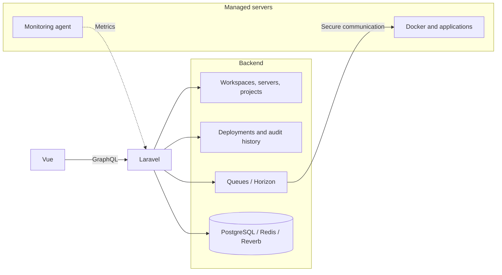

# Architecture

## Modules

Planned modules:

| Module                 | What belongs there                          |
| ---------------------- | ------------------------------------------- |
| `Identity`             | App auth                                    |
| `Workspaces`           | Resource ownership, membership, roles       |
| `Servers`              | Server inventory, connections, availability |
| `Projects`             | Applications, repositories, environments    |
| `Deployments`          | Deployment requests, execution, history     |
| `ContainerRuntime`     | Docker integration and container operations |
| `Monitoring`           | Metrics, alerts                             |
| `Notifications`        | App notifications and                       |
| `ConfigurationBuilder` | `compose.yaml` and `Dockerfile` generation  |
| `Audit`                | Records of actions                          |
